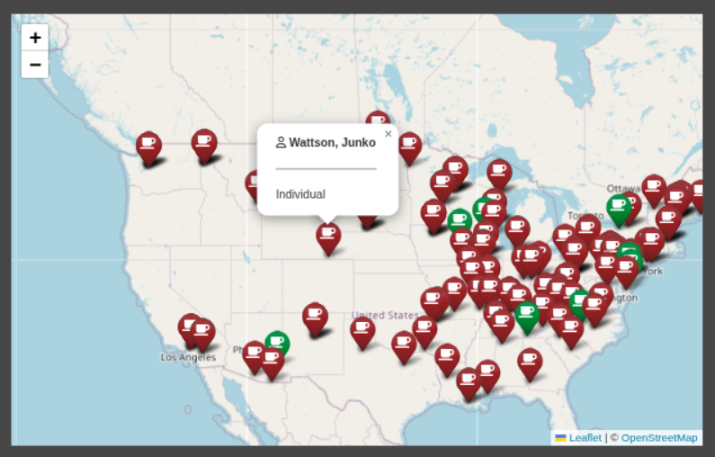

# SearchKit Maps Display

Implements a SearchKit display to put markers on a map using [leaflet.js](https://leafletjs.com/) and OpenStreetMap.

The extension is licensed under [AGPL-3.0](LICENSE.txt).

## Installation

Learn more about installing CiviCRM extensions in the [CiviCRM Sysadmin Guide](https://docs.civicrm.org/sysadmin/en/latest/customize/extensions/).

## Documentation

See https://lab.civicrm.org/extensions/searchkitmaps/-/tree/main/docs

## Support and Maintenance

This extension is supported and maintained with the help and support of the CiviCRM community by [MJW](https://www.mjwconsult.co.uk).

We offer paid [support and development](https://mjw.pt/support) as well as a [troubleshooting/investigation service](https://mjw.pt/investigation).
