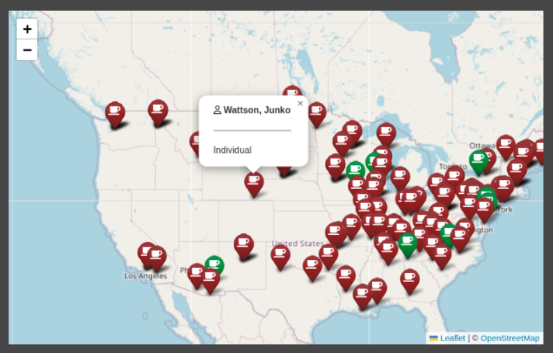
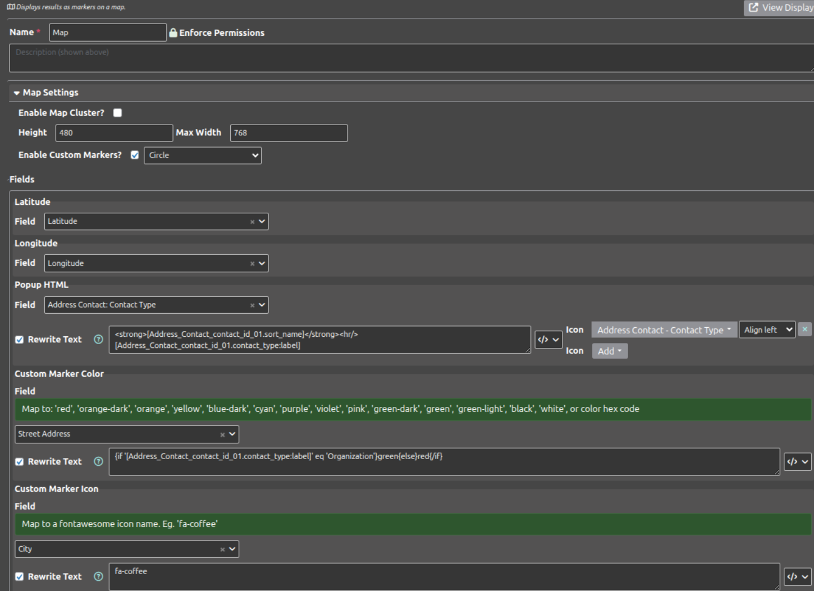
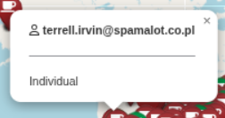

# SearchKit Maps Display

Implements a SearchKit display to put markers on a map using [leaflet.js](https://leafletjs.com/) and OpenStreetMap.

The extension is licensed under [AGPL-3.0](https://lab.civicrm.org/extensions/searchkitmaps/-/blob/main/LICENSE.txt).



## Features

- Supports custom marker colours and icons (using fontawesome icons).
- Supports grouping (clustering) markers on zoom.
- Supports customisable popup.

### Advanced features (requires additional configuration for Formbuilder)

- Supports "Click table/grid row to highlight on map".
- Supports "Filter table by visible map area".

**Requires CiviCRM 6.16+.** These features rely on core changes ([civicrm-core#35330](https://github.com/civicrm/civicrm-core/pull/35330), [civicrm-core#35331](https://github.com/civicrm/civicrm-core/pull/35331)) - see `info.xml`'s `<compatibility>` for the enforced minimum.

For this to work a table (or grid) display and a map display should be placed on the same form.

#### Filter table by visible map area

Add two range-filter fields named exactly `geo_code_1` (latitude) and `geo_code_2` (longitude) to the form - `filterByBounds()` looks them up by these names. See the demo form's `<af-field>` markup for the exact field configuration required.

#### Click table/grid row to highlight on map

`CRM.searchkitmaps` provides these functions:

- `filterByBounds()` - filters a table by bounds on the map if the table has Lat/Lon filters by range enabled (see above).
- `highlightOnMap(id)` - accepts an entity ID and highlights it on the map (opens the popup).
- `addSearchDisplayTableClickToHighlightOnMap(displayName)` - give it the name of a searchDisplay **table** and it will add a click-handler to each currently-rendered row which triggers `highlightOnMap()`.
- `addSearchDisplayGridClickToHighlightOnMap(displayName)` - the same, but for a searchDisplay **grid** (each grid item gets the click-handler instead of each table row).
- `addSearchDisplayLoadListener(tagName, displayName, onLoad)` - registers `onLoad(displayName)` to run every time the named search display (re-)renders its results, eg. after a filter/sort/page change. `tagName` is `crm-search-display-table` or `crm-search-display-grid`. Use this to (re-)bind the click-handlers above to whichever rows/grid-items are currently on screen - re-binding is necessary because the search display replaces its rows/grid-items on every run.

For example, to highlight table rows on click:

```js
CRM.searchkitmaps.addSearchDisplayLoadListener(
  'crm-search-display-table',
  'MySearch_Table_1',
  CRM.searchkitmaps.addSearchDisplayTableClickToHighlightOnMap
);
```

See the demo form (and search) for the full embedded javascript required to make this work: `afsearchSearchkitMapsAndTableDemo`

## Installation

Learn more about installing CiviCRM extensions in the [CiviCRM Sysadmin Guide](https://docs.civicrm.org/sysadmin/en/latest/customize/extensions/).

## Configuration

1. Create a new Search which contains Latitude/Longitude information (eg. Contacts with Addresses).
2. Add a display of type "Map".
3. Make sure that it selected the Latitude, Longitude fields correctly.

### Popup

The "Popup" accepts HTML and can be populated from another field in the search display. By using rewrite and icons you can create rich content.



For example:
```html
<strong>[Address_Contact_contact_id_01.sort_name]</strong>
<hr/>[Address_Contact_contact_id_01.contact_type:label]
```
with icon = contact type gives you:


### Custom markers

Enable "custom markers" in settings and choose your style (eg. Circle).

Select fields for "Custom Marker Colour" and "Custom Marker Icon".

Custom Marker Icon should map to a fontawesome icon name: eg. "fa-coffee".
Use rewrite with smarty to select different icons for different data in the field.

Custom Marker Colour should map to a colour or hex code. For example:
```smarty
{if '[Address_Contact_contact_id_01.contact_type:label]' eq 'Organization'}
green
{else}
red
{/if}
```
will set the marker to "green" for an Organization and "red" otherwise.


## Roadmap

[LeafletJS](https://leafletjs.com/) supports many features, multiple mapping providers, polygons etc.

It would be simple to add support for additional mapping providers (probably via a dropdown selector in the display configuration).

If your CiviCRM database has coordinates to map out polygons (eg. voter districts) then it could be extended to display those.

## Support and Maintenance

This extension is supported and maintained with the help and support of the CiviCRM community by [MJW](https://www.mjwconsult.co.uk).

We offer paid [support and development](https://mjw.pt/support) as well as a [troubleshooting/investigation service](https://mjw.pt/investigation).